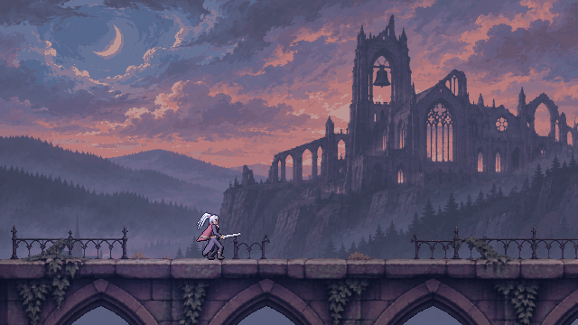

# Requiem Waltz

고딕 성을 탐험하며 지상과 공중에서 무기를 바꿔 싸우는 2D 도트 액션 로그라이트. 현재 실행되는 첫 장면은 석교 위에서 이동, 착지, 조명과 픽셀 밀도를 시험하는 공간이다.

Godot **4.7.2 표준판**에서 [project.godot](project.godot)을 열고 **F5**를 누른다. **A/D 또는 ←/→**로 움직이고 **Space**로 점프한다. 패드는 왼쪽 스틱·십자키와 아래쪽 얼굴 버튼을 사용한다. **F11**은 전체 화면 전환이다.

| 문서 | 내용 |
| --- | --- |
| [게임 디자인 방향](doc/design/game-direction.md) | 전투, 탐험과 런의 관계, 주인공, 서사, HUD와 메뉴 |
| [프로젝트 설정과 실행](doc/technical/project-setup.md) | 실행 경로, 입력, 배율, 충돌 레이어, 오디오, Windows 내보내기 |
| [아트·사운드 제작](doc/art/production-pipeline.md) | SpriteKiln, PixelFX, PlinkFX, 대화 원화와 LiveIllustration |
| [캐릭터 기준 포즈](doc/art/character-study.md) · [환경 원화와 도트화](doc/art/environment-sources.md) | 캐릭터 원본과 피벗, 환경 생성 프롬프트, 게임 텍스처 재생성 |
| [개발 로드맵](doc/production/roadmap.md) | 첫 전투실, 10~15분 소구역, 일정과 범위, GitHub·Steam 준비 |
