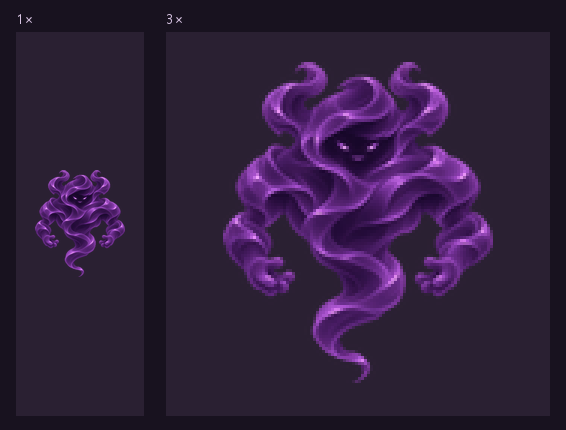

# 레퀴엠 본모습 정면 원화



[장갑과 대포의 도트](../../../../../doc/art/requiem-forms-v003-details.png)를 재질 기준으로 삼아 내장 ImageGen으로 [정면 원화](../../sources/v002/originals/requiem-front.png)를 만들었다. 뿔과 어깨의 주름이 깊은 얼굴 그늘을 만들고, 그 안에 눈과 입이 비친다. 팔꿈치와 손이 보이며, 양팔과 몸통 사이에는 여백이 있다. 몸통 아래로는 한 줄의 꼬리가 말린다.

SpriteCut에서 [정면 셀](prepared/front.png)을 128×128px로 등록했다. 피벗은 몸통 중심선 아래 (64, 119)에 있다. 뿔을 제외한 머리 꼭대기에서 피벗까지의 높이는 104px다. [등록 검수](prepared/review.png)에서 전체 외곽과 피벗을 확인할 수 있다.

[원화 프롬프트](../../sources/v002/imagegen-prompt.txt) · [원화 입수 기록](../../sources/v002/source.json) · [SpriteCut 등록 정보](prepared/views.json)

```powershell
../SpriteCut/.venv/Scripts/python.exe -m spritecut views prepare artsource/spritecut/waltz/materials/v007/registration.json .local/requiem-front-v007 --only front
```
