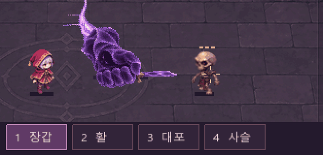

# 레퀴엠 4번 무기 사슬



[v004 사슬 시안](../../../sources/form-studies/v004/README.md)의 얼굴과 고리 그림으로 제작했다. 사슬은 왈츠 곁에 따로 떠 있는 보랏빛 영체에서 시작해 한손검의 손잡이 끝까지 이어진다. 대기 중에는 고리가 늘어지고 얼굴 주변의 주름이 일렁인다. 앞뒤 조준 방향에서도 얼굴이 읽히도록 같은 정면 셀을 회전하고 좌우로 반전한다.

봉인의 방에서 **4**를 누르면 사슬로 바뀐다. 다른 무기와 같은 보랏빛 불꽃을 쓰고, EXIT는 118ms, ENTER는 130ms에 맞췄다. 좌클릭하면 조준 방향으로 검을 던졌다가 칼날을 틀어 회수한다. 나갈 때 적을 밀고 돌아올 때 끌어당긴다. 같은 적에게 각 구간에서 한 번씩 맞힐 수 있다.

[SpriteCut 시트](sheets/clips.json) · [관절과 장착점](tracks.json) · [게임 검수](../../../../../../tools/pixelfx/review_requiem_chain.gd)

```powershell
node tools/pixelfx/render_requiem_chain_materials.mjs
../SpriteCut/.venv/Scripts/python.exe artsource/spritecut/waltz/authoring/build_requiem_chain.py
$chainGodot = 'C:/Godot_v4.7.2-stable_win64.exe/Godot_v4.7.2-stable_win64_console.exe'
& $chainGodot --headless --path . --import
& $chainGodot --headless --path . --fixed-fps 60 --script tools/pixelfx/review_requiem_chain.gd
```

PixelFX 0.3.1 공유 리비전 `4ec9a35938d2b0da20cdb19ca72e9de8d6cf4b19`와 [SpriteCut 제작 리비전](revision.json)을 사용했다. 헤드리스 검수는 좌우 투척·회수 타격, 예약 전환, 공통 전환 불꽃, 사망과 재시작을 확인한다.
