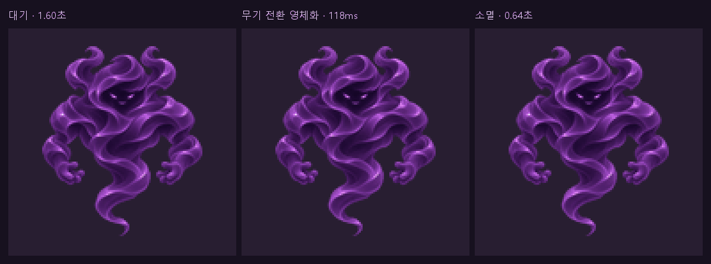

# 레퀴엠 본모습 정면 모션 v001



[정면 원화 셀](../../../materials/v007/prepared/front.png)의 얼굴·몸통·양팔·꼬리를 [정면 리그](../../../materials/v008/parts/parts-grid.png)에서 나눴다. 어깨와 몸통의 밝은 주름이 먼저 일렁이고 손끝과 꼬리가 뒤따른다. 각 구간의 변형을 관절 주변에서 섞어 주름이 이어지게 했다.

| 모션 | 길이 | 시트 |
| --- | --- | --- |
| 대기 | 1,600ms · 40컷 · 반복 | [대기 SpriteCut 시트](sheets/clips.json) |
| 무기 전환 영체화 | 118ms · 6컷 | [영체화 SpriteCut 시트](../../requiem_true_exit/v001/sheets/clips.json) |
| 본모습 등장 | 130ms · 6컷 | [등장 SpriteCut 시트](../../requiem_true_enter/v001/sheets/clips.json) |
| 소멸 | 640ms · 16컷 | [소멸 SpriteCut 시트](../../requiem_true_vanish/v001/sheets/clips.json) |

영체화에서는 팔을 몸 쪽으로 끌어들이고 꼬리를 감으면서 기존 무기 EXIT와 같은 118ms에 유체가 한 점으로 모인다. [장갑으로 전환하는 ¼배속 영상](../../requiem_true_exit/v001/previews/to-gauntlet-slow.gif)은 이 동작 뒤에 기존 장갑 ENTER를 붙이고, 게임에서 쓰는 공통 보랏빛 불꽃을 겹쳐 재생한다. 소멸에서는 팔과 꼬리 가장자리에서 작은 입자가 먼저 떨어지고 눈매가 잠시 남았다가 흐려진다.

등장은 공통 유체 중심에서 밝은 주름과 눈매가 먼저 솟고, 양팔과 꼬리가 뒤따라 펼쳐지며 대기 첫 컷과 같은 자세에 안착한다. [등장 실제 속도](../../requiem_true_enter/v001/previews/enter-full-speed.gif) · [장갑에서 본모습으로 전환하는 ¼배속 영상](../../requiem_true_enter/v001/previews/from-gauntlet-slow.gif)

네 시트는 128×128px 정면 셀, 피벗 (64, 119), 같은 컬러·노멀·이미시브 프레임 영역을 쓴다. 전환 유체의 중심은 셀의 (64, 57)에 있다.

[공통 전환 불꽃](../../../../../pixelfx/requiem_forms.mjs)은 폭이 넓고 끝이 갈라지는 중앙 불꽃이 먼저 솟고, 낮은 양옆 불꽃이 뒤따른다. 갈라진 끝과 양옆에서 작은 보랏빛 불씨가 떨어져 나와 위로 흩어진다. 기존 16컷과 피벗을 사용하며, PixelFX 0.3.1 공유 리비전 `4ec9a35938d2b0da20cdb19ca72e9de8d6cf4b19`에서 굽는다.

```powershell
../SpriteCut/.venv/Scripts/python.exe artsource/spritecut/waltz/authoring/build_requiem_true_form.py --output-root .local/requiem-front-motion
node tools/pixelfx/render_requiem_forms.mjs shift
../SpriteCut/.venv/Scripts/python.exe artsource/spritecut/waltz/authoring/review_requiem_true_form.py
```

첫 명령은 v007의 정면 원화와 v008의 관절을 읽어 SpriteCut으로 다시 굽는다. 두 번째 명령은 게임의 전환 불꽃 아틀라스를 갱신한다. 마지막 명령은 제작 폴더의 시트와 전환 불꽃으로 검수 GIF를 만든다.
