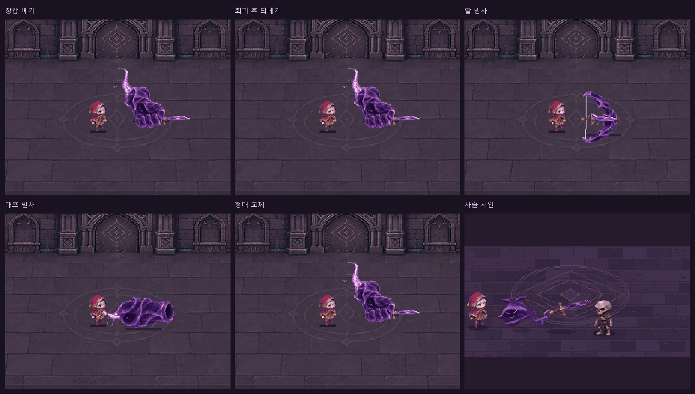

# 레퀴엠 모션 검수

[본모습 대기·영체화·소멸과 사망 연출](true-form/v002/README.md)



| 형태 | 화면에서 확인할 동작 |
| --- | --- |
| 장갑 | 손잡이를 쥔 대기, 일반 베기, 회피 후 되베기. 일반 공격 클립 365ms. |
| 활 | 시위를 당기며 장착한 한손검을 발사하고 다시 대기 자세로 돌아간다. 공격 클립 329ms. |
| 대포 | 장전하며 팽창하고, 포구에서 한손검이 빠져나오며 반동한다. 공격 클립 351ms. |
| 형태 교체 | 각 형태가 118ms 동안 유체로 풀리고, 다음 형태가 130ms 동안 모인다. GIF에서 장갑 → 활 → 대포 → 장갑을 재생한다. |
| 사슬 | [별도 전투 시안 v004](v004/README.md). 사슬에 연결된 검이 갈 때 한 번, 방향을 바꿔 돌아올 때 한 번 맞힌다. |

장갑·활·대포와 형태 교체는 봉인의 방에서 녹화했다. 기존 세 형태의 대기 클립은 660ms이고 우측 전면·우측 후면과 좌측 반전을 사용한다. [재질 비교](spectral-forms/v001/README.md)와 [검집·장례종·전갈 꼬리 콘셉트](v001/README.md)도 열어 볼 수 있다.

프로젝트 루트에서 `node tools/pixelfx/render_requiem_true_form.mjs` 실행 후 Godot으로 새 텍스처를 가져온다. 검수 스크립트는 실제 입력과 사망 연출의 좌우 반전을 확인하고 `.local/requiem-motion-capture/`에 프레임을 저장한다.

```powershell
$requiemGodot = 'C:/Godot_v4.7.2-stable_win64.exe/Godot_v4.7.2-stable_win64_console.exe'
& $requiemGodot --path . --fixed-fps 60 --resolution 640x360 --script tools/pixelfx/review_requiem_motions.gd
../SpriteCut/.venv/Scripts/python.exe tools/pixelfx/render_requiem_motion_overview.py
```
