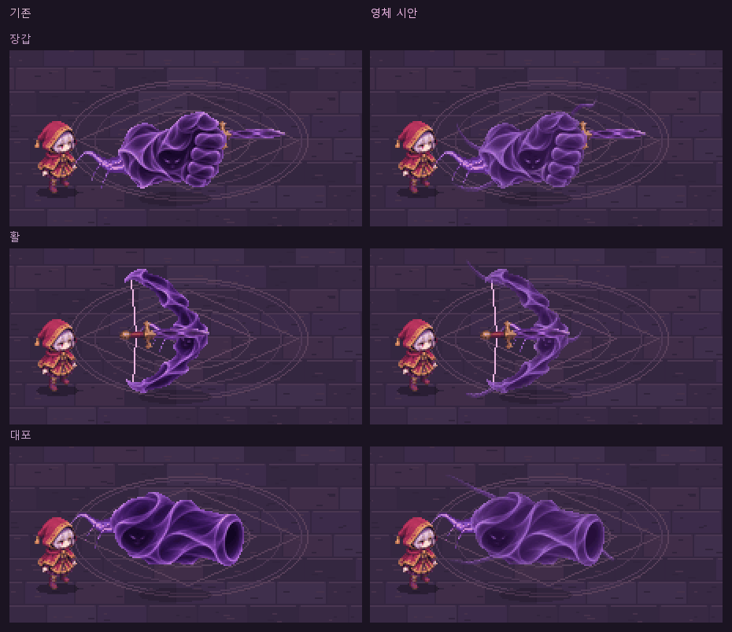

# 레퀴엠 장갑·활·대포 영체 시안 v001



[사슬 v004](../../v004/README.md)의 깊은 보랏빛 그늘과 반투명한 가장자리를 기존 세 형태의 우측 전면 도트에 입혔다. 왼쪽과 오른쪽은 같은 대기·공격 프레임, 검 장착점, 시위와 발사 효과를 사용한다.

| 형태 | 빛이 흐르는 방향 |
| --- | --- |
| 장갑 | 손목 안쪽에서 손가락을 향해 흐르고, 손을 조일 때 주름이 밝아진다. |
| 활 | 활의 몸통에서 위아래 끝으로 갈라져 흐른다. 끝부분에서 가느다란 영체가 풀린다. |
| 대포 | 뒤쪽에서 포구 쪽으로 흐른다. 장전 중에는 몸체가 부푸는 박자에 맞춰 주름이 밝아진다. |

[영체 재질 레시피](../../../../../../pixelfx/requiem_forms_spirit.mjs)와 [비교 GIF 렌더러](../../../../../../../tools/pixelfx/render_requiem_forms_spirit_preview.py)로 다시 만들 수 있다. Node, 공용 PixelFX, Pillow와 Windows 맑은 고딕을 사용한다.

```powershell
../SpriteCut/.venv/Scripts/python.exe tools/pixelfx/render_requiem_forms_spirit_preview.py
```
