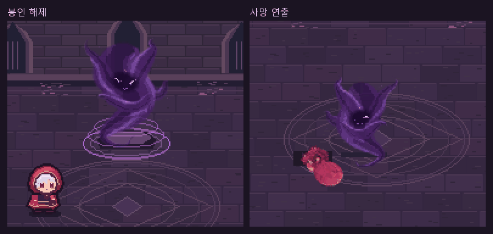

# 레퀴엠 본모습 v001



[영체 사슬 v004](../../v004/README.md)의 짙은 보랏빛 그늘과 반투명한 주름을 레퀴엠의 본모습에도 적용했다. 뿔과 눈빛은 연무 속에서 드러나고, 몸은 비대칭으로 말리는 여러 겹의 연무에서 하나의 긴 꼬리로 좁아진다. 뿔 끝과 꼬리는 서로 다른 박자로 움직인다.

- [봉인 해제](../../../../../../../scenes/rooms/waltz_combat.tscn)에서는 E로 봉인을 풀면 영체가 봉인 위로 피어오른다. 대화 중에는 1.6초 호흡을 반복한다.
- [사망 연출](../../../../../../../scenes/rooms/requiem_forms_review.tscn)에서는 조작구에서 본모습이 나타나 왈츠 쪽을 바라본다. 눈매가 낮아지고 꼬리가 말리면서 영체가 보랏빛 조각으로 흩어진다.

[PixelFX 레시피](../../../../../../pixelfx/requiem_true_form.mjs)는 투명 아틀라스 두 장과 Godot SpriteFrames를 만든다. 두 클립은 128×128px 셀과 얼굴 기준 피벗 (64, 50)을 공유한다. GIF는 Godot에서 두 장면을 프레임 단위로 촬영한 결과다.

```powershell
node tools/pixelfx/render_requiem_true_form.mjs
```

Node와 Python, 공용 PixelFX 0.3.1 리비전 `4ec9a35938d2b0da20cdb19ca72e9de8d6cf4b19`를 사용했다.
