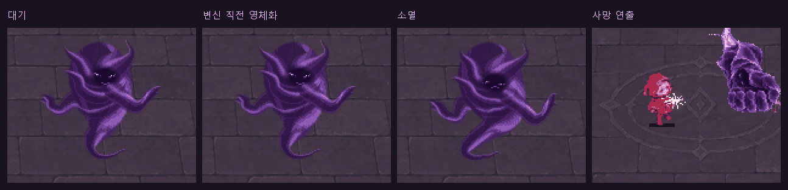

# 레퀴엠 본모습 v002



장갑·활·대포와 같은 보라색 주름이 지니의 팔과 꼬리까지 이어진다. 깊은 그늘에 눈과 입이 비치고, 대기 중에는 뿔과 양팔이 꼬리와 서로 다른 박자로 움직인다.

| 동작 | 시간 | 투명 스프라이트 시트 |
| --- | --- | --- |
| 대기 | 1.60초 반복 · 48컷 | [대기 PNG](../../../../../../../assets/vfx/requiem_forms/true_form_idle.png) |
| 변신 직전 영체화 | 0.30초 · 10컷 | [영체화 PNG](../../../../../../../assets/vfx/requiem_forms/true_form_liquefy.png) |
| 소멸 | 0.40초 · 13컷 | [소멸 PNG](../../../../../../../assets/vfx/requiem_forms/true_form_vanish.png) |
| 왈츠를 바라보는 사망 연출 | 1.30초 원본 · 40컷 | [사망 연출 PNG](../../../../../../../assets/vfx/requiem_forms/true_form_concern.png) |

영체화는 팔과 꼬리를 말아 보라색 유체 덩어리로 모은다. 소멸은 꼬리를 끌어올리면서 바깥쪽부터 투명해지고 입자가 퍼진다. 사망 연출은 왈츠 쪽으로 눈매를 낮추다가 1.10초에 본모습의 소멸 컷으로 이어진다.

네 시트는 128×128px 셀, 30fps, 피벗 (64, 50)을 공유한다. [PixelFX 레시피](../../../../../../pixelfx/requiem_true_form.mjs)는 PNG, 타이밍 JSON과 Godot SpriteFrames를 생성한다. [전체 모션 검수](../../README.md)에서 무기 형태와 함께 볼 수 있다.

```powershell
node tools/pixelfx/render_requiem_true_form.mjs
```

공용 PixelFX 0.3.1 리비전 `4ec9a35938d2b0da20cdb19ca72e9de8d6cf4b19` 기준이다.
