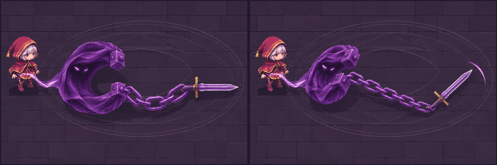
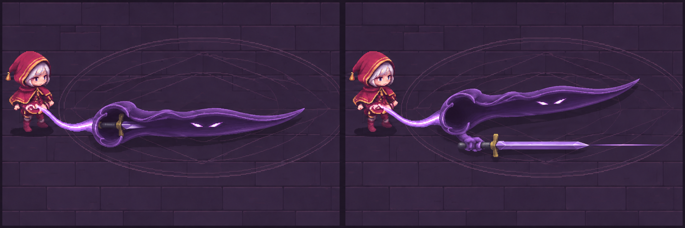
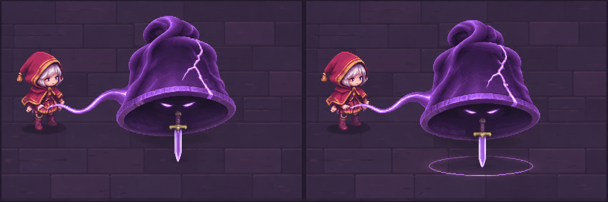
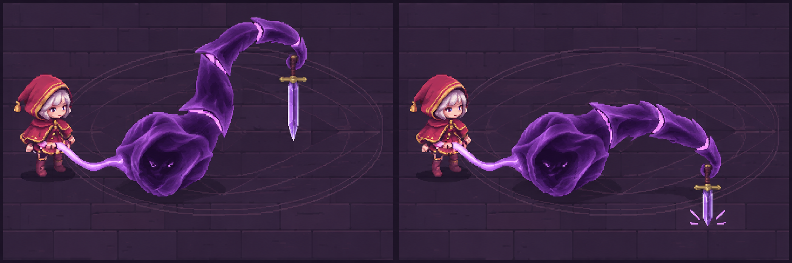

# 레퀴엠 추가 형태 시안 v001

각 이미지의 왼쪽은 대기 자세, 오른쪽은 공격의 핵심 자세다. 기존 [장갑과 대포 시안](../../../../../../doc/art/requiem-forms-v003-details.png)을 참고해 왈츠와 한손검을 함께 배치했다. 전투용 스프라이트 제작에 앞서 실루엣과 칼날의 움직임을 비교하는 콘셉트 시안이다.

## 사슬

손잡이에 매달린 사슬이 대기 때는 늘어지고 회수할 때는 팽팽해진다. 검은 회수 방향에서 비스듬히 돌아 칼날이 적을 가른다.



## 검집

검집 입구에 걸린 황동 가드가 보인다. 발도할 때 검집이 들리고 그 아래로 칼날이 직선으로 뻗는다.



## 장례종

한손검이 갈라진 종 아래에 추처럼 매달린다. 칼끝이 바닥에 닿으면 그 지점에서 원형 파동이 번진다.



## 전갈 꼬리

위로 말린 마디가 앞쪽으로 펴지면서 끝에 매단 검을 한 지점에 내리꽂는다.



<details>
<summary>ImageGen 프롬프트</summary>

내장 ImageGen으로 공통 프롬프트 뒤에 각 형태 지시를 이어서 생성했다. 사슬과 검집은 생성된 이미지를 참조해 한 차례 더 편집했다.

### 공통

```text
Use case: stylized-concept. Asset type: Requiem Waltz gothic top-down pixel game, art direction draft, horizontal two-pose comparison. The attached existing game screenshot is only a visual reference for the exact little red-hooded girl, floating purple ghost, perspective, pixel scale and the one existing sword. Create a new form for the SAME floating spirit. One landscape image, two equally sized scenes side by side, separated by a straight dark 2-pixel divider at exactly 50%, both scenes use the same fixed right-facing three-quarter top-down game camera and identical zoom. No text, lettering, numbers, HUD, border, targets, or arrows. Left scene shows the idle silhouette, right scene shows the attack's most readable instant. In each scene the small red-hooded child stands on the far left as a scale reference, connected to the spirit with a single narrow lilac wisp. Keep WALTZ's pose the same on both sides. Only ONE physical sword per scene, identical between scenes and modeled directly after the reference: slim straight double-edged violet-silver one-handed steel blade, small muted yellow brass crossguard and short dark hilt. Use very dark muted plum dungeon brick floor, subdued grid, deliberate chunky pixel clusters with dark contour, rich near-black grape shadows and thin lilac ridges. Existing screenshot aesthetic, not painterly. Longest dimension of spirit body near one and a half times the height of child. Keep both scenes tightly legible with breathing room, no clipped parts. Ghost expressions should be visible as a subtle pair of lavender eyes in a recessed shadow. Avoid bloom, soft gradients, 3D renders, excessive particles or ornaments.
```

### 사슬

```text
Form: CHAIN. Left: the ghost's compact body is a thick tilted open C-shaped shackle ring, clear DARK hole as negative space, eyes inside one thick side of the ring; three distinct loosely hanging oval links run from that body to the sword's dark hilt. The sword lies almost horizontally to the right with the brass crossguard clear. Right: the same big shackle body has tightened and leans back, a taut continuous tether of individually visible oval purple chain links runs on a strong low diagonal to the right to the same sword's dark hilt; the sword is being reeled back diagonally, blade tip trails outward. Add one short lilac slash mark beside the single sword to signal cutting on the return. The chain connects at the HILT in both scenes, no other loose chains. Left sag versus right taut straight line is the action.
```

편집 프롬프트

```text
Use case: stylized-concept. This is an edit to the attached two-panel Requiem Waltz chain-form pixel concept. Preserve the entire left panel and all elements of the right panel up to the last chain link, including divided composition, palette, shadows, dimensions and camera. Change ONLY the little sword and the slash mark in the right panel. Reposition the single sword to show a cutting moment as it is pulled back: its short dark hilt is held by the same last link at the same point and its blade points UPRIGHT and right at around minus 45 degrees, forming a strong wide angle with the chain which descends toward the right, visibly not collinear. Short narrow lavender cutting arc on the blade's outward side, clear of the blade, with clean pixel edges. Brass crossguard and original straight violet silver sword design and length preserved. Do not change ANY other element. No text.
```

### 검집

```text
Form: SCABBARD. Left: one long thin and flattened smoky purple scabbard points to the right, with a slight upward tilt; the inserted sword is half visible near the open mouth by the small brass crossguard and short dark handle on the left side. Low, slim, elongated planar silhouette, slit-like pink-lilac eyes in the scabbard side. Right: show the SAME hollow purple scabbard left of a fully withdrawn SINGLE sword, eye and dark open mouth visible, and a little purple tendril from the scabbard grips its dark sword handle. The physical sword points forward (right), visibly parallel to the straight forward draw path. A narrow linear lilac streak behind the blade indicates a straight quick draw cut. No arc, no second sword, no cannon muzzle.
```

편집 프롬프트

```text
Use case: stylized-concept. Refine the attached two-panel Requiem Waltz scabbard-form concept in place. Preserve the existing layout, character, palette and chunky pixel game camera in both panels. The only edit is to make the sword and scabbard interaction physically clear. In the left idle panel, scabbard is a slim solid smoky purple sheath with a closed right tip and only one opening at the LEFT end. The little dark handle and brass guard protrude left of that opening, with only a short sliver of silver-violet blade visible at the mouth. A readable tiny pair of eyes midway on the colored exterior. In the right attack panel, show the same intact ghost scabbard with the same rounded opening on the LEFT end and thin closed right tip, positioned a little higher and tilted slightly up, to make room in front and below for the weapon. One short smoky hand at the LEFT end grips the original sword's dark hilt. It has just drawn the sword out of the left opening and slashed FORWARD to the right, just beneath the sheath, with the gold crossguard and full short purple blade visible and a low narrow straight lavender trailing streak. The sword is held by the hand during the slash. No duplicated blade, no open body running the length of the sheath, no white bloom, no text.
```

### 장례종

```text
Form: FUNERAL BELL. Left: one unmistakably flared floating medieval violet funeral bell viewed from the same game camera with a wide low oval rim and a single lightning-like crack in its side. Faint eyes in the shadow under the rim. The single violet one-handed sword hangs vertically from the center of the mouth like the bell's clapper, its recognizable small brass crossguard and lower blade visible. Right: same bell hovering just above a sword that has stabbed POINT FIRST into the stone directly underneath the mouth, sword vertical tip touching ground; one thin lilac elliptical ripple expands on the floor from the blade point. Bell is the same size and centered in both views. Rune-free minimal, silhouette defined by rim and crack, no stand and no decorative crosses.
```

### 전갈 꼬리

```text
Form: SCORPION TAIL. Both poses depict an abstract ghost made from a squat floating blunt spirit head with recessed little eyes, and exactly three thick mobile tapered purple armored tail segments arcing up and forward from the back, plus a small sheath gripping the normal sword's short dark HILT at the tail tip. The entire tail and sword form one connected silhouette. The character is the TAIL ONLY, no insect legs, pincers, or full scorpion. Left: high deeply hooked question-mark silhouette, sword hangs down from the upper end, normal brass crossguard clearly visible. Right: tail has uncoiled forward and down so that one real short sword strikes point-first down at a single floor tile in front, little localized 3-pixel impact spark, head still toward the left. Preserve the readable articulated segments and use small purple accents at their hinges.
```

</details>
