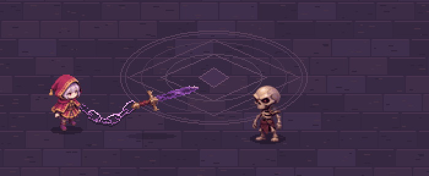

# 레퀴엠 사슬 동작 시안 v002



[사슬 형태 초안](../v001/chain.png)의 C자형 고리를 없앴다. 왈츠 곁에서 시작하는 보랏빛 사슬의 마지막 고리가 기존 한손검의 손잡이 끝에 직접 붙는다. 대기 중에는 사슬이 늘어지고 던지면 검 뒤로 펴진다.

| 시안 시간 | 자세 |
| --- | --- |
| 0.24–0.40초 | 검을 몸 쪽으로 짧게 당겨 던질 준비를 한다. |
| 0.40–0.60초 | 칼끝을 앞으로 향한 채 해골 위쪽으로 던진다. |
| 0.60–0.68초 | 사슬이 팽팽해지고 가장 먼 지점에서 검의 방향이 꺾인다. |
| 0.68–0.94초 | 검이 돌아오면서 칼날이 옆으로 서고, 0.78초에 해골을 벤다. |
| 0.94–1.18초 | 검이 왈츠 곁으로 돌아오고 사슬이 한 번 흔들리며 늘어진다. |

검의 위치와 각도, 사슬과 칼날 잔상은 [PixelFX 레시피](../../../../../pixelfx/requiem_chain.mjs)에 있다. [미리보기 스크립트](../../../../../../tools/pixelfx/render_requiem_chain_preview.py)는 봉인의 방 배경과 게임의 왈츠·검·해골 도트를 합성하고 2배 크기로 저장한다. Node와 Pillow가 필요하다. PixelFX는 공용 0.3.1 리비전 `4ec9a35938d2b0da20cdb19ca72e9de8d6cf4b19`를 사용했다.

프로젝트 루트에서 실행한다.

```powershell
../SpriteCut/.venv/Scripts/python.exe tools/pixelfx/render_requiem_chain_preview.py --version v002
```
