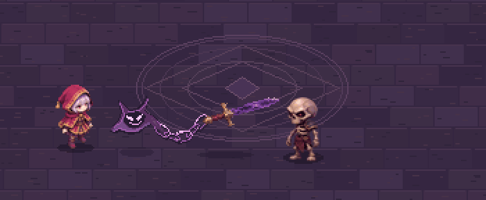

# 레퀴엠 사슬 동작 시안 v003



사슬의 왈츠 쪽 끝은 눈과 입, 두 뿔이 남은 레퀴엠의 보라색 유체로 풀린다. 유체는 공중에 떠서 첫 사슬 고리까지 흐르고, 왈츠와 영체 사이에는 투척부터 회수까지 틈이 남는다. 반대쪽 끝에는 기존 한손검의 손잡이가 붙는다.

| 동작 시간 | 자세 |
| --- | --- |
| 0.40–0.60초 | 한손검을 던진다. 0.46초에 칼끝이 해골에 닿으며 해골이 오른쪽으로 움찔한다. |
| 0.60–0.68초 | 검이 가장 먼 지점에 닿고 사슬이 팽팽해진다. 칼날이 옆으로 꺾이며 회수를 시작한다. |
| 0.68–0.94초 | 칼날이 돌아오며 0.80초에 같은 해골을 한 번 더 벤다. 해골이 왼쪽으로 움찔한다. |
| 0.94–1.18초 | 검이 레퀴엠 곁으로 돌아오며 사슬이 다시 늘어진다. |

움짤은 두 타격 순간을 각각 20ms 늘려 피격 자세가 읽히게 했다. [이전 회수 타격 시안](../v002/README.md)과 비교할 수 있다.

[PixelFX 레시피](../../../../../pixelfx/requiem_chain.mjs)와 [미리보기 스크립트](../../../../../../tools/pixelfx/render_requiem_chain_preview.py)로 재생성한다. Node와 Pillow가 필요하다. PixelFX는 공용 0.3.1 리비전 `4ec9a35938d2b0da20cdb19ca72e9de8d6cf4b19`를 사용했다.

```powershell
../SpriteCut/.venv/Scripts/python.exe tools/pixelfx/render_requiem_chain_preview.py --version v003
```
