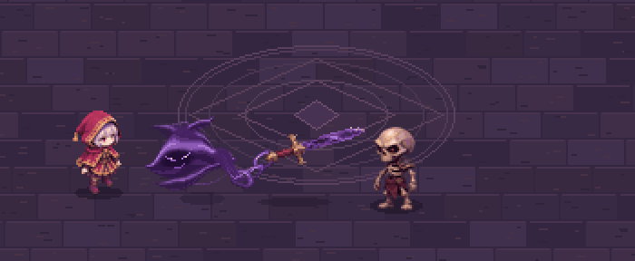

# 레퀴엠 사슬 동작 시안 v004



[v003 시안](../v003/README.md)의 띄워 둔 얼굴을 짙은 보라색 유체 안에 넣고, 주변에 얇은 주름과 연기를 더했다. 장갑·활·대포처럼 그늘 안에서 눈빛이 비친다. 유체가 첫 마디까지 가늘게 이어지고, 사슬 고리에는 반투명한 보랏빛이 흐른다.

왈츠와 영체 사이에는 공간이 있고, 한손검이 나갈 때 칼끝으로 한 번, 돌아올 때 칼날로 한 번 해골을 맞힌다.

[영체·사슬 명암 레시피](../../../../../pixelfx/requiem_chain_spirit.mjs)와 [검·사슬 동작 레시피](../../../../../pixelfx/requiem_chain.mjs)는 [미리보기 스크립트](../../../../../../tools/pixelfx/render_requiem_chain_preview.py)에서 실행한다. 기존 시안과 같은 공용 PixelFX 0.3.1과 Pillow를 사용한다.

```powershell
../SpriteCut/.venv/Scripts/python.exe tools/pixelfx/render_requiem_chain_preview.py --version v004
```
