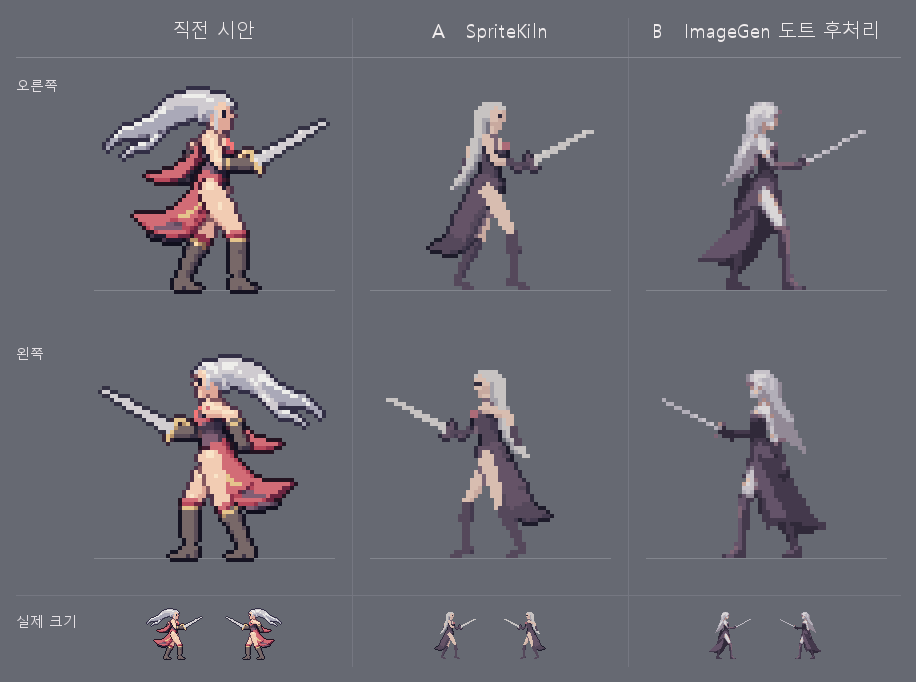

# 여검사의 측면 조명 기준 포즈

게임은 B의 생머리와 먹자주색 의상을 사용한다. 대기는 선택한 B 원본에서 발을 고정하고 상체와 머리 끝을 움직였다. 걷기와 달리기는 SpriteKiln의 좌우 포즈 시트에 B 원화를 참조해 ImageGen으로 각각 채색하고 64×64 셀로 도트화했다. [석교 동작 미리보기](../../artsource/spritekiln/vigil_motion/causeway.gif)

| 동작 | 방향당 프레임 | 기본 재생 시간 |
| --- | ---: | ---: |
| 대기 | 6 | 960ms |
| 걷기 | 8 | 840ms |
| 달리기 | 8 | 600ms |

걷기와 달리기의 재생 속도는 지면 이동 속도에 연동된다. [게임용 아틀라스](../../assets/actors/vigil/locomotion)는 가로 8칸, 세로 6줄이며 각 동작에서 오른쪽·왼쪽 순서로 두 줄을 쓴다. 컬러와 노멀은 같은 알파 윤곽을 쓴다. 노멀은 최종 도트의 실루엣과 머리·살결·천의 색면으로 만든 높이장에서 계산했다. 이미시브는 옷깃의 석류석 한 픽셀만 가산 합성한다. 실제 Godot 장면에서 광원을 좌우로 옮겨 표면 반응을 확인하고, 조명을 끈 뒤 발광 레이어를 껐다 켜 브로치가 남는지 확인했다. [조명 비교](../../artsource/spritekiln/vigil_motion/lighting.png)

보관된 원화에서 3종 아틀라스·프레임별 소켓·방향별 미리보기를 다시 만들 때는 저장소 루트에서 공유 가상환경의 Python으로 `artsource/spritekiln/vigil_motion/build.py`를 실행한다. [포즈 스펙](../../artsource/spritekiln/vigil_motion/motion.yaml) · [ImageGen 프롬프트](../../artsource/spritekiln/vigil_motion/imagegen-prompt.txt) · [후처리 스크립트](../../artsource/spritekiln/vigil_motion/build.py)

## 비교에 사용한 초기 A 정지 포즈

| 항목 | 값 |
| --- | --- |
| 프레임 | 64 × 64픽셀, 측면 동·서 각각 한 장. 캐릭터의 불투명 영역 높이는 47픽셀 |
| 정면 방향 | `idle_e`는 오른쪽, `idle_w`는 왼쪽. 오른손에 든 검을 양쪽에서 따로 렌더했다. |
| 지면 피벗 | 왼쪽 위 원점에서 (32, 56.74). 정수 배치 시 (32, 57) |
| 발 부착점 | `sole`은 지면 피벗과 일치한다. 검 끝 `sword_tip`은 동쪽에서 피벗 대비 (+25.42, −39.62), 서쪽에서 (−25.42, −39.62)픽셀 |
| 광원 반응 | 컬러와 노멀의 불투명 영역이 일치한다. 동쪽 528픽셀, 서쪽 527픽셀. 노멀의 +X는 화면 오른쪽, +Y는 위쪽, +Z는 관찰자 쪽이다. |
| 발광 영역 | 브로치에 동·서 각각 4픽셀 |

[플레이어 씬](../../scenes/actors/study_actor.tscn)은 컬러·노멀 아틀라스를 Godot `CanvasTexture`에 연결하고, 이미시브 아틀라스에서 같은 셀을 가산 합성한다. 좌상단을 발 원점 대비 (−32, −57)픽셀에 둔다.

## 작은 얼굴과 단순한 색면 비교



| 시안 | 실제 사용 색 | 64픽셀에서 읽히는 특징 |
| --- | --- | --- |
| 직전 시안 | 39색 | 밝은 허벅지와 붉은 옷자락의 대비가 크고 머리가 등 뒤로 넓게 퍼진다. |
| A · SpriteKiln | 13색 | 얼굴 영역이 6×7에서 4×6픽셀로 줄었다. 가는 팔, 검날과 앞다리가 구분된다. |
| B · 포즈 시트 → ImageGen → 도트 | 11색 | 12색 공통 팔레트를 적용했다. 몸판과 치맛단이 이어져 긴 윤곽이 남고, 반대쪽에서 보면 빈손이 허리 뒤로 내려온다. |

A와 B는 같은 높이와 발 위치로 맞췄다. 최초 석교 비교에서는 게임 조명 아래 정지 시안 두 컷의 컬러 텍스처만 교체했다. [같은 석교 위치에서 본 두 시안](../../artsource/spritekiln/studies/vigil_ab/room-comparison.png)

B에는 A의 좌우 포즈를 5단계 회색으로 단순화해 8배로 키운 시트와 사용자 비율 참조를 넣었다. 첫 생성에서 좌우 팔이 거의 거울상으로 보여 두 번째 생성에서 가까운 팔과 먼 팔을 구분했다. 선택한 원본을 셀별로 나눈 뒤 정수리와 발 위치를 기준으로 균일하게 축소했다. 원본에 검날이 남아 있는 구간에서 한 픽셀 선이 이어지는지 검사했다. [입력 시트](../../artsource/spritekiln/studies/vigil_ab/pose-input.png) · [최종 프롬프트](../../artsource/spritekiln/studies/vigil_ab/imagegen-prompt.txt) · [생성 원본](../../artsource/spritekiln/studies/vigil_ab/imagegen.png) · [팔레트와 정렬 기준](../../artsource/spritekiln/studies/vigil_ab/calibration.json)

## 원본에서 다시 만들기

[캐릭터 원본](../../artsource/spritekiln/specs/characters/vigil/vigil.yaml)에 인체 비율, 머리와 의상의 형태, 무기와 정지 자세가 있다. [프로젝트 설정](../../artsource/spritekiln/spritekiln.toml)에 카메라와 도구 리비전을 기록했다. SpriteKiln 0.4.0의 CC0 측면 인체 템플릿과 얼굴·머리·검 키트를 사용했다. 생머리와 치맛자락은 각각 별도의 곡선으로 모델링했다. [SpriteKiln REUSE 기록](https://github.com/LucasJRamos/spritekiln/blob/17ae0ea8d822b9bb543e539118516ae37d25b114/REUSE.toml)

저장소 루트에서 아래 명령을 실행한다. 같은 부모 폴더에 있는 공유 SpriteKiln 가상 환경을 사용하며, 다른 위치에 설치한 경우 `SPRITEKILN_ROOT`로 경로를 지정한다.

```powershell
$kilnRoot = if ($env:SPRITEKILN_ROOT) { $env:SPRITEKILN_ROOT } else { '..\spritekiln' }
& "$kilnRoot\.venv\Scripts\python.exe" artsource/spritekiln/build_vigil.py
& "$kilnRoot\.venv\Scripts\python.exe" artsource/spritekiln/studies/vigil_ab/postprocess.py
```

[빌드 스크립트](../../artsource/spritekiln/build_vigil.py)는 스펙 검증과 전체 렌더를 수행하고 QA 결과를 확인한 뒤, 아틀라스 JSON에 기록된 사각형으로 컬러·노멀·이미시브를 각각 잘라낸다. 아틀라스, 피벗·소켓 JSON, QA 결과와 검토용 시트는 `artsource/spritekiln/out/vigil/`에 생성된다. 별도로 뽑은 양방향 전신·얼굴·관절 시트는 상위 `out/`의 `pose.png`, `face.png`, `arcs.png`에 있다. 편집 원본과 게임용 PNG는 Git으로 관리하고, `out/`과 모델 옆의 `.kilncache/`는 로컬에 둔다.

두 번째 명령은 보관된 ImageGen 원본으로 B의 좌우 컬러 PNG와 3열 비교본을 다시 만든다. 2026-11-18에 A 전체 렌더에서 오류·경고 0개를 확인했고, 캐시 없는 재렌더에서 아틀라스 3장과 소켓 JSON의 바이트가 각각 일치했다. B도 같은 원본과 보정값으로 후처리를 반복했을 때 두 PNG와 비교본이 일치했다.
